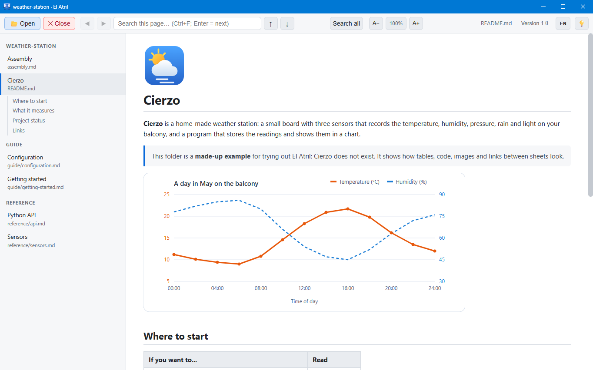
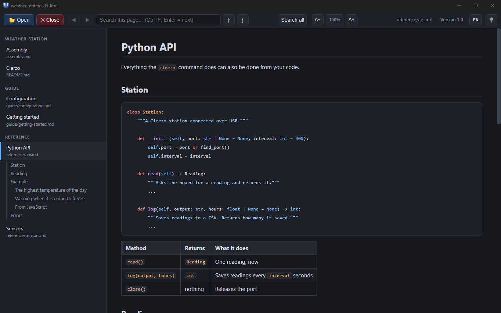

<p align="center"></p>

# El Atril

*[Versión en español](README.md)*

**A Markdown reader for Windows.** Open a folder and El Atril (Spanish for *the lectern*) shows
all its `.md` pages, formatted, in a light or dark theme, with a side panel to jump between
them, search, and back / forward navigation, like a small documentation website.



It is meant for reading documentation: a project's docs, notes, a guide split into several
linked files. It is read-only; keep editing your `.md` files in your usual editor and El Atril
shows the changes as soon as you save.

- A single `.exe`, no installer.
- In English and Spanish, in a light and a dark theme.
- It does not connect to the internet.

## Download

Get `El Atril.exe` from the [latest release](https://github.com/spaizor/el-atril/releases/latest)
and run it: there is nothing to install. The `.exe` is not signed, so the first time Windows may
show the blue SmartScreen warning: click *More info* → *Run anyway*.

## Features

### Reading

- **Open any folder** with the *Open* button or Ctrl+O. Subfolders are included.
- **Starts on the front page**: if there is a `README.md`, `LEEME.md` or `index.md` at the root,
  it opens that one first.
- **Picks up where you left off**: when you go back to a folder, it opens the last page you read,
  scrolled to the same spot.
- **Live reload**: if you edit the open page in another program and save it, El Atril updates it
  within a second without losing your place. New, renamed or deleted pages show up in the
  panel on their own too. It only checks file dates (it does not re-read anything until a file
  changes), so it does not slow the computer down.
- **Tables, task lists, strikethrough and code blocks**, on top of regular Markdown.
- **Syntax highlighting**: code blocks that name their language (` ```python `, ` ```powershell `,
  ` ```json `...) are coloured, in both themes. Blocks without a language stay plain.
- **Images**: images from the folder used in your pages (`` or
  ``) are shown, with paths relative to the page, like links. Images from
  the internet are not loaded: a small box with their text is shown instead, the same as when an
  image is missing or too large (over 15 MB).



### Getting around

- **Side panel** listing every page, grouped by folder and shown by its title (the first
  `# Title` in the file).
- **Page outline**: under the open page, the side panel lists its headings so you can jump to
  each section. The section you are reading is highlighted.
- **Links between pages**: a link to another `.md` in the folder opens inside El Atril,
  including links to a section (`page.md#section`). Web links open in your browser.
- **Links to other files** in the folder (PDF, images, documents...) open with their Windows
  program, and links to a folder open in File Explorer. They are marked with a small ↗. For
  safety, programs and scripts (`.exe`, `.bat`, `.ps1`, `.py`...) are never opened and appear
  greyed out.
- **Back and forward** like a browser (Alt+← and Alt+→).
- **Recent folders**: on startup, the side panel lists the last folders you opened so you can
  go back to them with one click (the × removes them from the list). The *Close* button or
  Ctrl+W closes the open folder and goes back to that list.
- **Excel files in the folder** get their own section in the panel; they open in Excel, outside
  El Atril.

### Searching

- **Search** in the current page, highlighting matches regardless of case and accents.
- **Search across all pages**, with a short snippet for each result.

### Your way

- **Light and dark theme**: by default it follows Windows (and switches on its own when you
  change it in Windows). The light bulb at the top right switches to light, to dark, or back to
  following Windows (shown with a small "A"). It is remembered for next time.
- **In English or Spanish**: by default, in the Windows language (Spanish if Windows is in
  Spanish, Catalan, Galician or Basque; English otherwise). The *ES* / *EN* button at the top
  right switches language or goes back to following Windows (shown with a small "A"). It is
  remembered for next time.
- **Adjustable font size** with the *A−* and *A+* buttons, Ctrl+mouse wheel or Ctrl+ +/−
  (Ctrl+0 resets it). It is remembered for next time.
- **Help at hand**: click the version number at the top right (or on the start page) to open
  this README inside El Atril, in the window's language. Back takes you to what you were reading.

## Requirements

- Windows 10 or 11.
- **Microsoft Edge WebView2 Runtime**, which draws the window. It ships with Windows 11 and with
  an up-to-date Windows 10; if it is missing, it is a free download from Microsoft.
- To run from source: **Python 3.13**.

## Usage

When it opens, click **Open folder…** and choose the folder with your documents.

You can also **drag a folder or a `.md` file onto the `.exe`**: a folder opens straight away,
and a `.md` file opens its folder right on that page. To open `.md` files with a double click:
right-click a `.md` file → *Open with* → *Choose another app* → find `El Atril.exe` and tick
*Always use this app*.

The same works from the command line:

```powershell
& "El Atril.exe" "C:\path\to\my docs"
& "El Atril.exe" "C:\path\to\my docs\guide.md"
```

### Keyboard shortcuts

| Key | Action |
|---|---|
| Ctrl+O | Open another folder |
| Ctrl+W | Close the folder and go back to the recent list |
| Ctrl+F | Go to the search box |
| Enter / Shift+Enter | Next / previous match (also F3 / Shift+F3) |
| Ctrl+Enter | Search all pages |
| Esc | Clear the search |
| Alt+← / Alt+→ | Back / forward |
| F5 or Ctrl+R | Reload the folder and the current page by hand (it already happens on its own) |
| Ctrl+wheel or Ctrl+ +/− | Larger / smaller font |
| Ctrl+0 | Reset the font size |

## Privacy and security

El Atril does not connect to the internet and only reads the files in the folder you open. All
it stores, in `%APPDATA%\El Atril`, is:

- `recientes.json`: the list of recently opened folders (their paths, none of their content).
- `memoria.json`: the font size, the theme, the language and, for each folder, the name of the
  last page you read and how far down you were.

Delete those files and El Atril starts from scratch.

Opening a document cannot run anything:

- Web links inside your documents open in your browser only if you click them, and images from
  the internet are not loaded.
- Pages may contain HTML, but El Atril strips whatever could run something or load from outside
  (scripts, frames, forms...), and the page itself is forbidden from connecting to the internet.
- Links to programs and scripts are never opened.

## Known limitations

- It skips hidden folders (starting with `.`) and `node_modules`, `__pycache__`, `venv` and
  `site-packages`, which are usually full of third-party docs.
- In very large folders it lists at most the first 2000 pages, so it does not hang.
- Only tested on Windows 11.

## Running from source

```powershell
git clone https://github.com/spaizor/el-atril.git
cd el-atril
py -3.13 -m venv .venv
.venv\Scripts\python -m pip install -r requirements.txt
.venv\Scripts\python main.py
```

To try it without looking for a folder, the repository includes a sample one (the one in the
screenshots), in Spanish and in English:

```powershell
.venv\Scripts\python main.py ejemplo\estacion-meteo
.venv\Scripts\python main.py ejemplo\weather-station
```

### Building the .exe

```powershell
.venv\Scripts\pyinstaller build.spec
```

This creates `dist\El Atril.exe`, a single file that runs without Python installed.

## How it works inside

It is a [pywebview](https://pywebview.flowrl.com/) window showing an HTML page; Markdown is
turned into HTML with [mistune](https://github.com/lepture/mistune) and code blocks are coloured
with [Pygments](https://pygments.org/). File and function names in the code are in Spanish.

| File | What it does |
|---|---|
| `main.py` | Start-up: creates the window, with the folder or `.md` page passed to it, or with none |
| `app/biblioteca.py` | Walks the folder, turns each page into HTML (with its images embedded) and searches them (pure Python, no window) |
| `app/recientes.py` | The list of recently opened folders |
| `app/memoria.py` | What is remembered between sessions: font size, theme, language and the last page of each folder |
| `app/ventana.py` | The window and the functions the page calls from JavaScript |
| `app/web/` | The page: `index.html`, `estilo.css` and `app.js`; the interface texts in both languages, `textos.json`; and the icon, `icono.ico` |
| `icono/` | The icon drawing as SVG: `icono.svg` and `icono_pequeno.svg` (for 16-24 px) |
| `capturas/` | The screenshots in these READMEs |
| `ejemplo/` | A made-up sample folder, in Spanish (`estacion-meteo`) and in English (`weather-station`) |
| `build.spec` | PyInstaller recipe to build the `.exe` |

## Version history

The version history is in the [Spanish README](README.md#historial-de-versiones).

## License

[MIT](LICENSE): you may use, copy, modify and distribute it freely, keeping the license notice.
