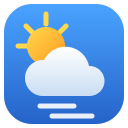
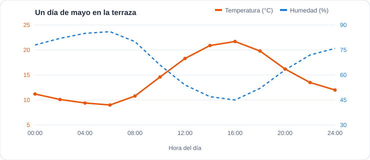

# Cierzo

**Cierzo** es una estación meteorológica casera: una placa pequeña con tres sensores que apunta
la temperatura, la humedad, la presión, la lluvia y la luz de tu terraza, y un programa que
guarda las lecturas y las enseña en una gráfica.

> Esta carpeta es un **ejemplo inventado** para probar El Atril: Cierzo no existe. Sirve para
> ver cómo quedan las tablas, el código, las imágenes y los enlaces entre hojas.

## Por dónde empezar

| Si quieres... | Lee |
|---|---|
| Montar la estación | [Montaje](montaje.md) |
| Instalar el programa y ver la primera lectura | [Primeros pasos](guia/primeros-pasos.md) |
| Cambiar cada cuánto se mide o dónde se guarda | [Configuración](guia/configuracion.md) |
| Saber qué mide cada sensor y con qué precisión | [Sensores](referencia/sensores.md) |
| Usar las lecturas desde tu propio código | [API de Python](referencia/api.md) |

## Qué mide

- **Temperatura**, **humedad** y **presión**, con un sensor BME280.
- **Lluvia**, con un pluviómetro de balancín.
- **Luz**, con una fotorresistencia.

Las lecturas de ejemplo de un día entero están en [lecturas.csv](datos/lecturas.csv).

## Estado del proyecto

- [x] Lectura de los tres sensores
- [x] Guardado en CSV y en SQLite
- [x] Gráfica diaria
- [ ] Avisos de helada
- [ ] Veleta y anemómetro

## Enlaces

- [Hoja de datos del BME280](https://www.bosch-sensortec.com/products/environmental-sensors/humidity-sensors-bme280/)
- [Documentación de MicroPython](https://docs.micropython.org/)
