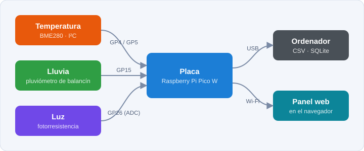

# Montaje

Todo cabe en una caja estanca de 10 × 10 cm. No hace falta soldar si usas una placa de pruebas.

## Piezas

| Pieza | Cantidad | Para qué | Precio aprox. |
|---|:-:|---|--:|
| Raspberry Pi Pico W | 1 | La placa que lee los sensores | 8 € |
| Sensor BME280 | 1 | Temperatura, humedad y presión | 6 € |
| Pluviómetro de balancín | 1 | Lluvia | 12 € |
| Fotorresistencia + resistencia de 10 kΩ | 1 | Luz | 1 € |
| Caja estanca IP65 | 1 | Proteger la placa | 7 € |
| Cable micro USB | 1 | Alimentación y datos | 3 € |
| **Total** | | | **37 €** |

## Esquema de conexiones

| Sensor | Pin del sensor | Pin de la placa |
|---|---|---|
| BME280 | SDA | GP4 |
| BME280 | SCL | GP5 |
| Pluviómetro | Señal | GP15 |
| Fotorresistencia | Salida | GP26 (ADC) |

## Pasos

1. Conecta el BME280 a los pines **GP4** y **GP5**, y su alimentación a **3V3** (¡no a 5 V!).
2. Conecta el pluviómetro entre **GP15** y **GND**.
3. Monta la fotorresistencia con su resistencia de 10 kΩ y lleva la salida a **GP26**.
4. Mete la placa en la caja y saca el BME280 por fuera, a la sombra.
5. Enchufa el USB al ordenador y sigue con los [primeros pasos](guia/primeros-pasos.md).

> **Ojo con el sol.** Un sensor de temperatura al sol marca hasta 10 °C de más. Ponlo a la
> sombra y donde corra el aire.

## Comprobar que funciona

Con todo conectado, este programa de prueba debe escribir una lectura:
[leer_sensor.py](scripts/leer_sensor.py). Si no sale nada, repasa la
[tabla de problemas](guia/primeros-pasos.md#si-algo-falla).
