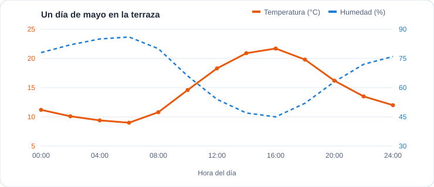

# Sensores

Qué mide cada sensor, entre qué valores y con cuánta precisión.

## Resumen

| Magnitud | Sensor | Rango | Precisión | Unidad |
|---|---|--:|--:|:-:|
| Temperatura | BME280 | −40 a 85 | ±0,5 | °C |
| Humedad | BME280 | 0 a 100 | ±3 | % |
| Presión | BME280 | 300 a 1100 | ±1 | hPa |
| Lluvia | Balancín | 0 a 200 por hora | ±5 % | mm |
| Luz | Fotorresistencia | 0 a 100 | orientativa | % |

## Temperatura, humedad y presión

El **BME280** mide las tres cosas a la vez y habla con la placa por I²C. Así se ve un día
normal de mayo:

La humedad sube de noche y baja a mediodía, justo al revés que la temperatura.

## Lluvia

El pluviómetro de balancín tiene una cucharilla doble que vuelca cada vez que se llena. Cada
vuelco son **0,28 mm** de lluvia; la placa solo cuenta vuelcos.

| Lluvia en una hora | Cómo se llama |
|--:|---|
| menos de 2 mm | Débil |
| de 2 a 15 mm | Moderada |
| de 15 a 30 mm | Fuerte |
| más de 30 mm | Muy fuerte |

## Luz

La fotorresistencia no da una medida exacta: sirve para saber si es de día, si está nublado o
si alguien ha dejado la luz de la terraza encendida. El valor va de `0` (oscuro) a `100`
(sol directo).

## Mantenimiento

- [ ] Cada mes: limpiar el balancín de hojas y polvo.
- [ ] Cada seis meses: comprobar que la caja sigue cerrando bien.
- [ ] Cada año: comparar la temperatura con un termómetro de fiar.

Para conectar cada sensor, mira el [esquema del montaje](../montaje.md#esquema-de-conexiones).
