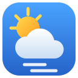
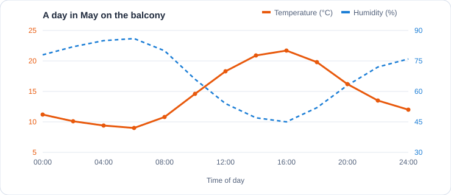

# Cierzo

**Cierzo** is a home-made weather station: a small board with three sensors that records the
temperature, humidity, pressure, rain and light on your balcony, and a program that stores the
readings and shows them in a chart.

> This folder is a **made-up example** for trying out El Atril: Cierzo does not exist. It shows
> how tables, code, images and links between sheets look.

## Where to start

| If you want to... | Read |
|---|---|
| Build the station | [Assembly](assembly.md) |
| Install the program and see your first reading | [Getting started](guide/getting-started.md) |
| Change how often it measures or where it saves | [Configuration](guide/configuration.md) |
| Know what each sensor measures and how accurately | [Sensors](reference/sensors.md) |
| Use the readings from your own code | [Python API](reference/api.md) |

## What it measures

- **Temperature**, **humidity** and **pressure**, with a BME280 sensor.
- **Rain**, with a tipping-bucket rain gauge.
- **Light**, with a photoresistor.

A whole day of sample readings is in [readings.csv](data/readings.csv).

## Project status

- [x] Reading the three sensors
- [x] Saving to CSV and SQLite
- [x] Daily chart
- [ ] Frost warnings
- [ ] Wind vane and anemometer

## Links

- [BME280 datasheet](https://www.bosch-sensortec.com/products/environmental-sensors/humidity-sensors-bme280/)
- [MicroPython documentation](https://docs.micropython.org/)
