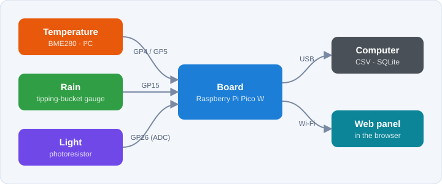

# Assembly

Everything fits in a 10 × 10 cm weatherproof box. No soldering needed if you use a breadboard.

## Parts

| Part | Quantity | What for | Approx. price |
|---|:-:|---|--:|
| Raspberry Pi Pico W | 1 | The board that reads the sensors | €8 |
| BME280 sensor | 1 | Temperature, humidity and pressure | €6 |
| Tipping-bucket rain gauge | 1 | Rain | €12 |
| Photoresistor + 10 kΩ resistor | 1 | Light | €1 |
| IP65 weatherproof box | 1 | Protecting the board | €7 |
| Micro USB cable | 1 | Power and data | €3 |
| **Total** | | | **€37** |

## Wiring diagram

| Sensor | Sensor pin | Board pin |
|---|---|---|
| BME280 | SDA | GP4 |
| BME280 | SCL | GP5 |
| Rain gauge | Signal | GP15 |
| Photoresistor | Output | GP26 (ADC) |

## Steps

1. Connect the BME280 to pins **GP4** and **GP5**, and its power to **3V3** (not 5 V!).
2. Connect the rain gauge between **GP15** and **GND**.
3. Wire the photoresistor with its 10 kΩ resistor and take the output to **GP26**.
4. Put the board in the box and leave the BME280 outside it, in the shade.
5. Plug the USB cable into your computer and go on to [getting started](guide/getting-started.md).

> **Mind the sun.** A temperature sensor in direct sunlight reads up to 10 °C too high. Put it
> in the shade, somewhere the air moves.

## Checking that it works

With everything connected, this test program should print one reading:
[read_sensor.py](scripts/read_sensor.py). If nothing comes out, go through the
[troubleshooting table](guide/getting-started.md#if-something-goes-wrong).
