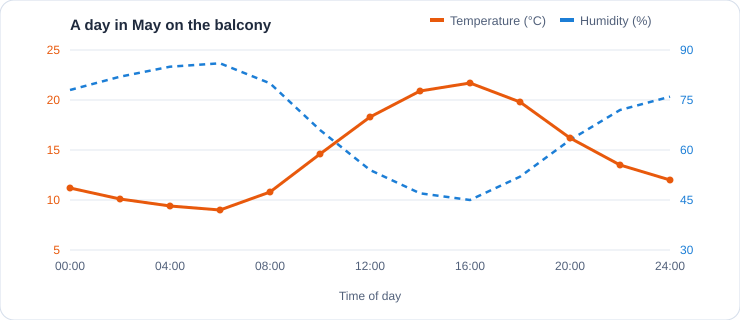

# Sensors

What each sensor measures, between which values and how accurately.

## Summary

| Quantity | Sensor | Range | Accuracy | Unit |
|---|---|--:|--:|:-:|
| Temperature | BME280 | −40 to 85 | ±0.5 | °C |
| Humidity | BME280 | 0 to 100 | ±3 | % |
| Pressure | BME280 | 300 to 1100 | ±1 | hPa |
| Rain | Tipping bucket | 0 to 200 per hour | ±5 % | mm |
| Light | Photoresistor | 0 to 100 | rough | % |

## Temperature, humidity and pressure

The **BME280** measures all three at once and talks to the board over I²C. This is what an
ordinary day in May looks like:

Humidity rises at night and falls at midday, just the opposite of temperature.

## Rain

The tipping-bucket gauge has a double spoon that tips over every time it fills up. Each tip is
**0.28 mm** of rain; the board only counts tips.

| Rain in one hour | What it is called |
|--:|---|
| less than 2 mm | Light |
| 2 to 15 mm | Moderate |
| 15 to 30 mm | Heavy |
| more than 30 mm | Very heavy |

## Light

The photoresistor does not give an exact measurement: it tells you whether it is daytime,
whether it is cloudy or whether someone left the balcony light on. The value goes from `0`
(dark) to `100` (direct sun).

## Maintenance

- [ ] Every month: clear leaves and dust out of the bucket.
- [ ] Every six months: check that the box still closes properly.
- [ ] Every year: compare the temperature with a thermometer you trust.

To wire each sensor, see the [assembly diagram](../assembly.md#wiring-diagram).
